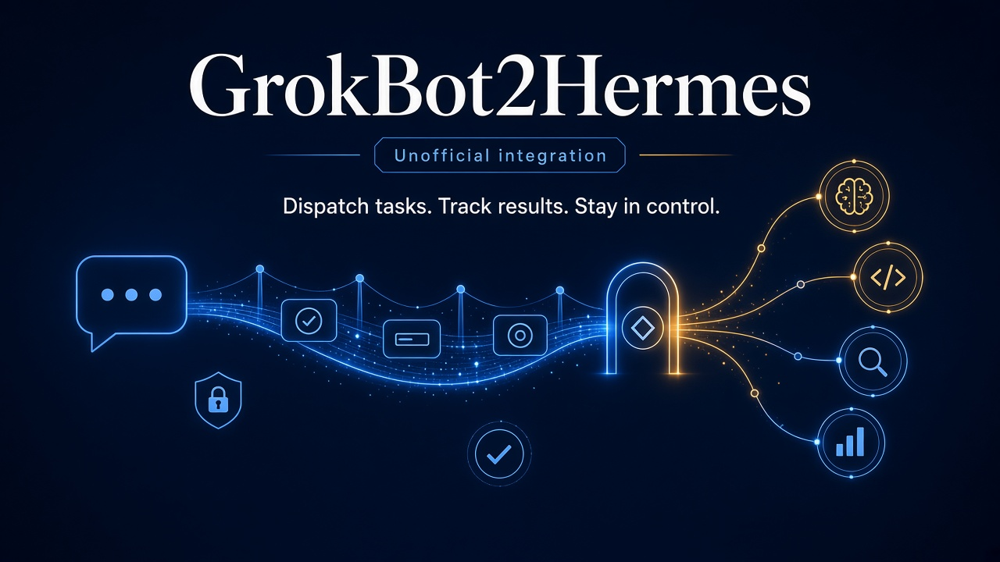

# GrokBot2Hermes

Dispatch tasks from Grok Bot to Hermes Agent. Not a migration tool.



> GrokBot2Hermes is an independent, unofficial tool. It is not affiliated
> with, endorsed by, or connected to xAI (Grok) or Nous Research (Hermes
> Agent). Grok and Hermes are trademarks of their respective owners.
> MIT licensed: see LICENSE.

## What it is and what it is not

It IS: a small Python 3.9+ command line client, `g2h`, single file plus a
three line launcher, standard library only. It dispatches a task to a
Hermes Agent gateway's Runs API, tracks it to a terminal state, writes a
crash-safe receipt, reports by exit code, and leaves human approvals to
humans.

It is NOT: a migration tool, a framework, a dashboard, a hosted service, a
team wrapper, or a library with API promises. It adds no auto-anything: no
auto-merge, no auto-approve, no auto-retry of caller errors.

## Requirements

- Python 3.9+ on macOS or Linux.
- A Hermes Agent gateway with the API server enabled and `API_SERVER_KEY`
  set (the gateway is what runs the agent; see the upstream Hermes Agent
  repository: https://github.com/NousResearch/hermes-agent).

## Install

```console
$ git clone https://github.com/dziduchm/grokbot2hermes
$ cd grokbot2hermes
$ chmod +x g2h
```

No pip install, no dependencies beyond the standard library.

## Quickstart

```console
$ export G2H_API_KEY=<your gateway key>        # or use a 0600 key file
$ export G2H_BASE_URL=http://127.0.0.1:8642    # optional, this is the default
$ ./g2h dispatch --input "Summarize the inbox and file it"
run_id: run_abc123
status: completed
output: Filed 3 threads.
$ echo $?
0
```

Prefer a key file over an env var:

```console
$ ./g2h dispatch --key-file /path/to/key-0600 --input "..."
```

Named profiles route under a prefix (`--profile coder` becomes
`/p/coder/v1/...`) and use that profile's own key. Receipts land in
`~/.local/state/grokbot2hermes/` (override with `G2H_RECEIPT_DIR`): mode
0600 files in a 0700 directory, one per dispatched task, safe to keep and
replay.

## Exit codes

Exit codes are the control plane: automation branches on them, never on
prose. The table is the single source of truth; it is mirrored in
`g2h.py`.

| Code | Meaning | Typical trigger |
|------|---------|-----------------|
| 0 | completed | run reached terminal status `completed` |
| 1 | internal error | unexpected client bug; scrubbed traceback |
| 2 | usage error | bad flags, empty input, invalid idempotency key chars |
| 3 | credential or config error | key missing, key file perms not 0600, receipt dir not 0700 |
| 5 | run failed | terminal `failed` |
| 6 | run cancelled | terminal `cancelled` (including after stop) |
| 7 | run interrupted | terminal `interrupted` (gateway shutdown / drain) |
| 10 | auth rejected | HTTP 401 (wrong key for this profile prefix) |
| 11 | not found | HTTP 404 (unknown run id, wrong profile, or expired retention) |
| 12 | idempotency conflict | HTTP 409 `idempotency_key_conflict` (same key, different payload) |
| 13 | rate limited or unavailable | 429/503 budget exhausted after retries |
| 14 | timeout | `--timeout` expired while non-terminal (includes parked `unknown`) |
| 16 | awaiting human control | `waiting_for_approval` / `pending_controls` observed |
| 18 | transport error | connection failures after retry budget |

Note: 409 `permission_denied` (a `session_id` another surface owns)
reports as a scrubbed diagnostic in the exit 12 family with its own
message text, since it is a caller error, not a key collision. 409
`stale_generation` on resolve subcommands maps to exit 12, and 409
`not_found` on them maps to exit 11, each with its own message.

## Examples

Cron one-shot, check later (the receipt carries the full task):

```console
$ ./g2h dispatch --no-wait --input "Nightly report"
run_id: run_abc123
receipt: ~/.local/state/grokbot2hermes/default/run-....json
$ ./g2h wait --receipt ~/.local/state/grokbot2hermes/default/run-....json
```

If the client or the machine dies mid-wait, rerunning `wait --receipt`
resends the stored bytes with the stored idempotency key: the gateway
either replays the original run or admits it once. Nothing runs twice.

CI job with a strict deadline:

```console
$ ./g2h dispatch --timeout 900 --max-retries 8 --input "Regressions?"
```

Exit 14 means "still running at your deadline": keep the receipt and poll
again; the task did not vanish.

Adapters that auto-dispatch tasks (the "Grok Bot" side) should read
docs/adapters/grokbot.md, including the never-auto-answer rules for human
controls.

## Run the tests

The suite runs the real client as a subprocess against an in-process mock
gateway; all api keys are generated throwaway strings:

```console
$ python3 -m unittest discover -s tests -v
```

What Hermes already gives you natively versus what this adds:

| Already in Hermes Agent | Added by g2h |
|---|---|
| Kanban, review lanes, webhooks, dashboards | crash-safe 0600 receipts |
| agent runs, sessions, approvals UI | idempotent dispatch with replay detection |
| multiplex profiles under /p/ | backoff with Retry-After honoring |
| stop and drain handling | a stable exit-code contract for automation |

## Security notes

Full policy: SECURITY.md. The api key grants full agent access, including
terminal commands on the agent host: treat it like a password. The key is
only ever read from `G2H_API_KEY`, a 0600 key file or stdin; it never
appears in argv, output, logs or receipts (a redaction wrapper scrubs
every output path). Authorization is never forwarded across redirects;
plain http to non-loopback hosts is refused unless you pass
`--allow-insecure-http` (which warns). Approval and clarify are manual
operator subcommands only.

## Version support and provenance

Developed against the Hermes Agent v0.22.7 Runs API as documented in the
upstream api server documentation; every HTTP contract was verified
against that documentation before implementation. Contracts that the
upstream doc leaves open are listed in docs/api-contracts.md under
"Implementation notes". Degradation behavior on older or newer gateways:
the capabilities probe fails soft to the core runs surface, unrecognized
statuses are polled with a warning instead of a guess, and the optional
SSE endpoint is skipped silently when absent.

Tested live (sanitised): one dispatch against a local gateway's named
profile route reached terminal `completed` with exit 0 and its reply
output; during that run the gateway reported a status the client had
never seen, and the client warned once in diagnostics, kept polling and
completed. Receipts were 0600 in a 0700 directory, and the api key
appeared in no output, receipt or log. Stop, replay, wrong-key and
wrong-profile paths were verified against the mock suite, not against
real runs.

## Licence and attribution

> Hermes Agent is made by Nous Research and is MIT licensed:
> https://github.com/NousResearch/hermes-agent
> This project contains no Hermes source code; it only calls its
> documented HTTP API.

MIT licensed; see LICENSE.
